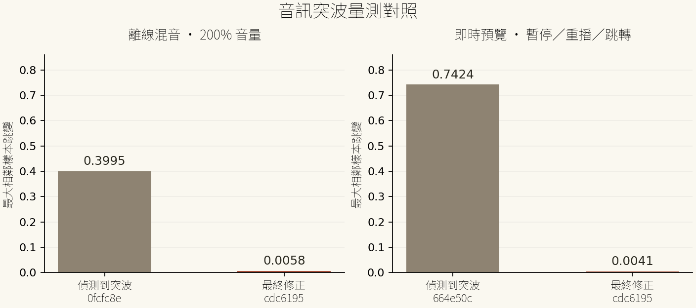

# 音訊量測

來源：[Actions 43581659661](https://github.com/peiyulin0520/VideoClip_2/actions/runs/43581659661)，source `cdc6195a7917b0acadce7a83c656e6a212379d51`，artifact14109275799。原始JSON直接取自成功完整CI，不改數據。

測試使用自行產生的3秒PCM（DC0.7加0.1正弦，非零邊界），UI剪段去掉約1–1.5秒聲音，再調200%音量。離線使用真正AudioRenderer/OfflineAudioContext，預覽以AudioWorklet量測master輸出，執行暫停、重播與跳轉。`peak`與`maxJump`均是浮點PCM振幅，1代表滿刻度；後者為相鄰樣本的最大差，不是音量百分比或每秒掉幀數。JSON含第一/最後樣本、端點樣本、最大跳變位置及即時排程事件。

|情境|峰值|最大相鄰跳變|
|---|---:|---:|
|100%離線|0.799988|0.003982|
|200%離線|0.9999998|0.005799|
|即時預覽（168960取樣）|0.768504|0.004122|

圖中「偵測到突波」為修正過程實測：0fcfc8e分段預設GainNode造成0.399471單樣本突波（Actions43579445961）；664e50c即時重排包絡造成0.742395（Actions43580593881）。「最終修正」使用本資料夾成功CI的JSON。不是未修改產品或使用者影片的基準跑分，不能推算實機FPS或所有素材改善幅度。截圖為合成色塊/片尾頁面，聲音連續性以波形驗收；Safari喇叭/耳機與長片流暢度仍待真機。

[原始JSON](audio-wave-metrics.json) · [可縮放SVG](audio-jump-comparison.svg)
